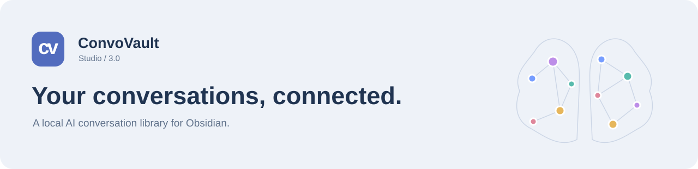
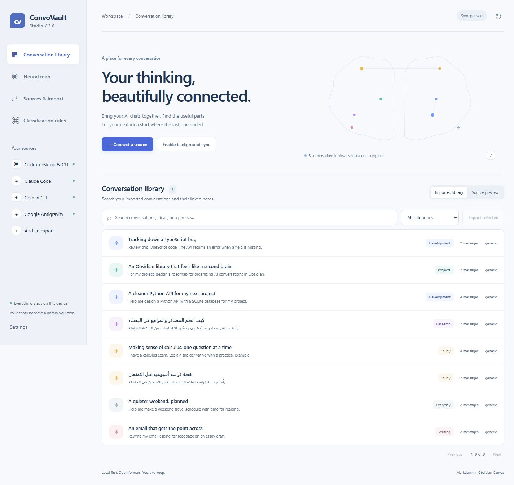
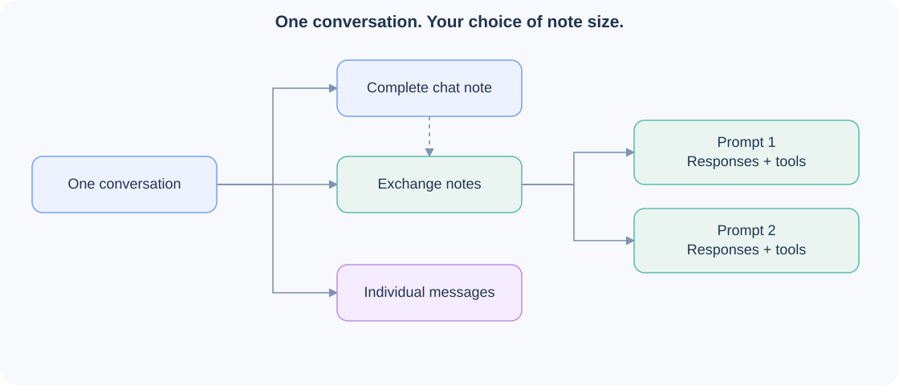
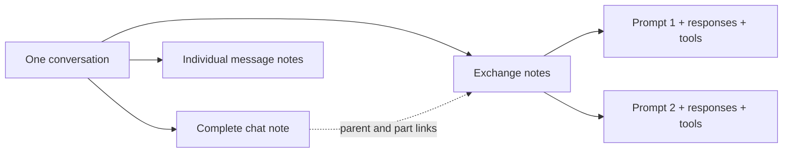
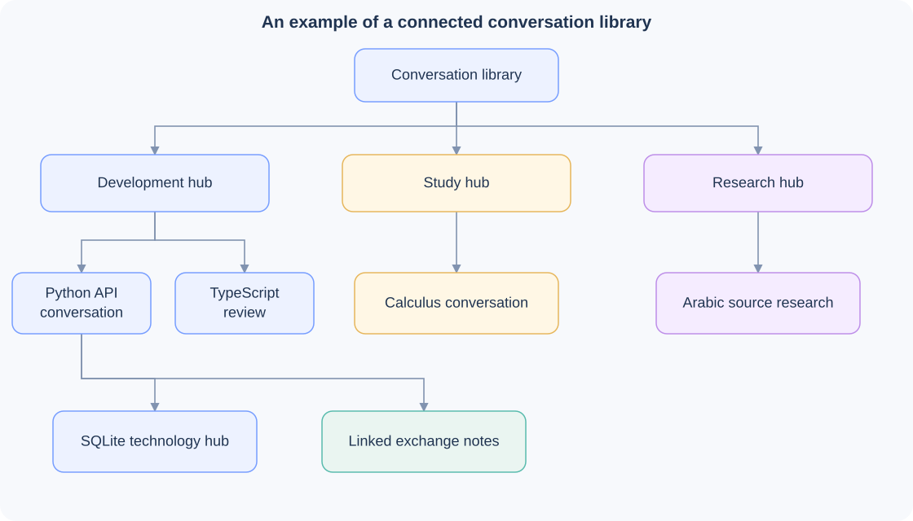
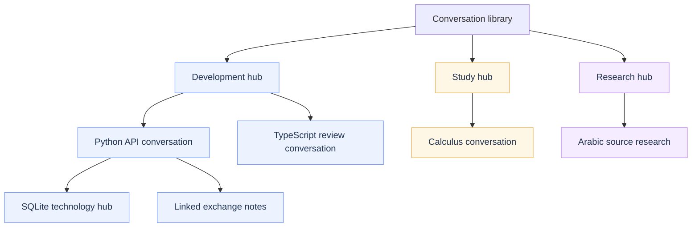
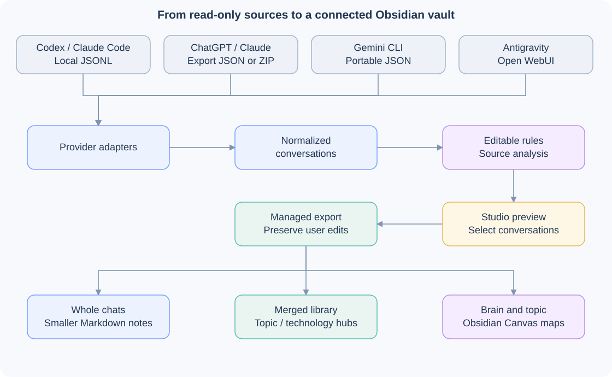
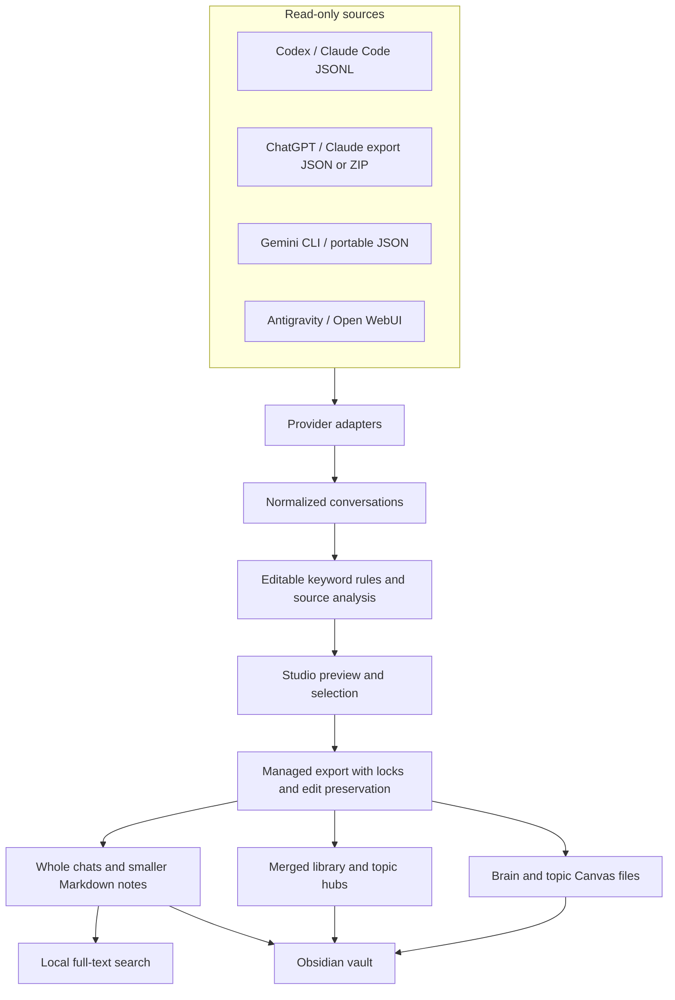

<div align="center">



**One local library for your AI conversations. Built for Obsidian.**

[](https://github.com/owrew/ConvoVault/actions/workflows/ci.yml)


[](LICENSE)

[Get started](#-get-started) · [See the interface](#-meet-studio) · [Supported sources](#-bring-your-conversations) · [How it works](#architecture) · [User guide](docs/USER-GUIDE.md)

</div>

---

## Your conversations should keep working for you

Useful ideas get buried in separate AI chat histories. ConvoVault brings supported exports and local transcripts into a library you can search, organize, and connect inside Obsidian.

Keep an entire conversation, break it into individual exchanges, or give every message its own note. Organize the result with editable categories, follow links between related technologies, and explore a colored Canvas map.

**No AI API keys. No content uploads. No cloud service required.** Studio and the core import/export workflow run on your device.

## ✨ Meet Studio



*The screenshot uses the included synthetic sample conversations. It does not display private user chats.*

| In Studio | What you can do |
| --- | --- |
| **Connect a source** | Discover common local transcript paths or choose a JSON, ZIP, JSONL, or supported SQLite source |
| **Preview before exporting** | Read conversations, inspect classification evidence, and choose which chats to import |
| **Find an idea** | Search exported Markdown, including the smaller notes linked to a conversation |
| **Make categories yours** | Edit names, colors, and English/Arabic keywords; override a whole chat's suggested category |
| **Explore connections** | Open conversations from a colored neural map and follow topic/technology hub notes |
| **Keep the library current** | Enable background sync for the configured source while Studio is running |

The tested graphical interface opens in your browser on a loopback-only local server. A separate native window is available through an optional dependency; that native-window installation has not been tested in this delivery.

## 🚀 Get started

### Run from source

Install **Python 3.9 or newer**, then:

```powershell
git clone https://github.com/owrew/ConvoVault.git
cd ConvoVault
python -m pip install .
python -m convovault gui
```

You can also double-click `Start-Studio.cmd` after cloning on Windows. If a locally built executable exists, the launcher uses it; otherwise it starts the Python interface.

### Your first import

1. Click **Connect a source** or choose a detected assistant in the sidebar.
2. Choose the source and an Obsidian vault **separate from the source folder**.
3. Pick a note mode and click **Preview conversations**.
4. Review the results, select the conversations, and click **Export selected**.
5. Open `AI Vault/Library.md`, `AI Vault/Brain.canvas`, or `AI Vault/Topics.canvas` in Obsidian.

> **Try it safely:** choose **Other / portable messages JSON** and select [`examples/studio-demo.json`](examples/studio-demo.json). Preview does not write vault files. The select-all checkbox selects the current page of up to 100 conversations.

### Windows portable build

To create an executable that includes Python:

```powershell
powershell -ExecutionPolicy Bypass -File scripts/build-windows.ps1
```

The build produces `release/ConvoVault-Studio.exe`. Double-click it to open Studio. Generated executables and build folders are excluded from Git; the source repository contains the build script. This locally verified Windows x64 build is unsigned.

### Optional native window

```powershell
python -m pip install '.[desktop]'
python -m convovault gui --native
```

This optional route uses pywebview. The browser interface is the verified default.

## 🔌 Bring your conversations

ConvoVault checks known transcript paths instead of searching account credentials, browser cookies, or encrypted caches. An existing directory is a discovery hint; preview confirms whether its contents are readable.

| Assistant / source | Supported input | How it is found |
| --- | --- | --- |
| **Codex desktop & CLI** | Local rollout JSONL, including archived sessions, messages, and tool calls | `CODEX_HOME`, or `~/.codex`; titles from `session_index.jsonl` |
| **ChatGPT** | Official `conversations.json` or export ZIP | Choose your downloaded export; imports the selected branch |
| **Claude.ai** | `conversations.json` or export ZIP with `chat_messages` | Choose your downloaded export |
| **Claude Code** | Local project JSONL, including tool records | `~/.claude/projects` |
| **Gemini CLI** | `session-*.json` with user/Gemini messages | `~/.gemini/tmp` |
| **Google Antigravity** | Existing brain JSONL, protobuf summaries, SQLite fallback | `~/.gemini/antigravity` |
| **Open WebUI** | SQLite `chat` table containing messages JSON | Common local locations, or a manually selected database |
| **LibreChat** | Portable JSON conversation objects with messages | Choose an exported JSON file |
| **LM Studio / other assistants** | Portable JSON using `messages` with role/content | Known LM Studio folders or a manually selected portable export |

**Format boundaries:** cloud-only Codex tasks are not downloaded; ChatGPT desktop account caches, Gemini web Takeout HTML, native proprietary LM Studio/Jan formats, and encrypted reasoning are not decoded. Recognized media gets an attachment marker; original attachments are not copied.

See the [source-format reference](docs/SOURCE-FORMATS.md) for schema details, path behavior, and the generic JSON example. Existing Antigravity support is retained; Gemini CLI and Gemini web are distinct sources.

## 📝 Choose the size of an idea

| Note mode | Output | Useful when… |
| --- | --- | --- |
| `conversation` | One complete Markdown note per chat | You want all the context in one place |
| `exchanges` | A chat index plus one note per user prompt and its following responses/tools | You want reusable question-and-answer units |
| `messages` | A chat index plus individual user, assistant, system, and tool notes | You want the smallest searchable pieces |
| `both` | The complete chat plus linked exchange notes | You want context and smaller building blocks |

Smaller notes receive their own keyword classifications and parent/previous/next links. An unfinished prompt remains an exchange. Leading assistant or tool records are retained rather than silently discarded.



<details>
<summary>View the Mermaid diagram source</summary>



</details>

Changing modes keeps previous output in the vault. Current indexes point to the newly selected mode; ConvoVault does not delete earlier notes.

## 🏷️ Classification you can inspect

The default categories are **Development, Study, Research, Writing, Projects,** and **Everyday**, with **Unsorted** for conversations that match no rule.

- Add literal words or phrases in English, Arabic, or another language.
- Pick each category's color.
- Inspect the matching phrases instead of trusting an unexplained score.
- Override a whole chat's category from its source preview.
- Re-export after changing rules to update existing Markdown notes.

Classification counts distinct matching phrases with Unicode word boundaries. Ties follow rule order. **This is local keyword matching, not semantic AI classification or a probability estimate.** Part notes are classified independently of a whole-chat override.

Optional local-model summaries and semantic classification are planned for a later stage. The current extractive overview is built from source content and recorded activity.

## 🧠 A library with connections

ConvoVault generates three complementary ways to explore:

| View | What it shows |
| --- | --- |
| **Studio neural map** | Conversations on the current results page; click a dot to open a chat; lines indicate shared categories or technologies |
| **`Brain.canvas`** | Colored note cards in a fixed, stylized two-hemisphere arrangement |
| **`Topics.canvas`** | Conversation cards organized in category columns |

Topic and technology hub notes create real links for Obsidian's ordinary graph. Related-conversation links identify shared technologies; they are not claims of model-inferred semantic similarity.



<details>
<summary>View the Mermaid diagram source</summary>



</details>

*Illustrative relationships based on the included sample data.*

> **About the brain shape:** it is an editable Obsidian Canvas, not a replacement for the built-in graph's force layout. `AI Vault/Graph colors.md` explains how to add corresponding graph color groups. Existing `.obsidian` settings are not changed.

Exported maps show up to **500 recent conversations**; the Markdown library includes every imported conversation. The GUI displays **100 results per page**. Editing a generated Canvas is supported: a later import preserves it and creates an incoming generated copy.

<a name="architecture"></a>

## ⚙️ How it fits together



<details>
<summary>View the Mermaid diagram source</summary>



</details>

The core and browser-based Studio use Python's standard library. Optional native-window dependencies are separate. Provider plugins can still use the existing `convovault.providers` entry-point interface.

### Generated vault structure

```text
Your Obsidian vault/
└── AI Vault/
    ├── Library.md
    ├── Graph colors.md
    ├── Brain.canvas
    ├── Topics.canvas
    ├── Chats/<provider>/
    ├── Exchanges/<provider>/<conversation-key>/
    ├── Messages/<provider>/<conversation-key>/
    ├── Topics/
    └── .convovault/
        ├── library.json
        └── library.previous.json
```

The selected mode determines which note folders are created. Source providers share one merged catalog without replacing one another's entries.

## 🔄 Background sync, on your terms

Enable sync in Studio to import the **entire currently configured source** at the saved interval, with a minimum interval of 30 seconds. New and changed chats are processed while unchanged generated files are skipped. Sync pauses on import errors and starts paused when Studio reopens.

Studio must remain running. This is not a Windows service, tray controller, or start-at-login installation. A manual export selection does not restrict a later whole-source background sync. ChatGPT/Claude web histories update only when you supply a new export.

## ⌨️ Keep the CLI

```powershell
# Discover known local sources and export options
python -m convovault discover

# Read and classify without writing to the vault
python -m convovault preview --provider codex --source "$env:USERPROFILE/.codex"

# Full chats plus individual exchanges
python -m convovault export --provider chatgpt --source conversations.json --vault "C:/My Vault" --note-mode both

# One note per normalized message
python -m convovault export --provider generic --source examples/studio-demo.json --vault "C:/Demo Vault" --note-mode messages

# Search exported content and linked part notes
python -m convovault search --vault "C:/My Vault" "database migration"

# Continuously sync a local source
python -m convovault watch --provider codex --source "$env:USERPROFILE/.codex" --vault "C:/My Vault" --interval 60

python -m convovault stats --vault "C:/My Vault"
```

Use `--rules rules.json` for custom classification and `--no-maps` to omit Canvas generation. CLI defaults follow the selected provider. `CONVOVAULT_PROVIDER`, `CONVOVAULT_SOURCE`, and `CONVOVAULT_VAULT` override defaults; earlier `AGY_*` variables remain supported.

The legacy `agy-exporter` command remains available. See the [migration notes](MIGRATION.md) before importing into an existing version 2 vault.

## 🛡️ Your originals stay yours

- Source transcripts are opened for reading; supported SQLite databases use read-only connections.
- Root-level vault indexes and existing Obsidian settings are not overwritten.
- Provider-qualified identities prevent different assistants' conversation IDs from colliding.
- Generated files are written atomically. Edited notes and maps are preserved through incoming copies.
- A vault lock prevents concurrent ConvoVault imports; the preceding manifest is retained for recovery.
- Imports merge into the library. Old notes are not automatically deleted.

A whole import is not a filesystem-wide transaction; interrupted runs can leave generated files to reconcile later. Keep your regular vault backups. Chats without source IDs use their position in the export to derive an identity, so rearranging those exports can change identities.

## ✅ Verification and practical limits

**45 local tests passed:** 15 original regression functions plus 30 new regression/integration tests. Coverage includes branch handling, Codex streams and tools, split notes, Arabic rules, provider collisions, edited-file preservation, Canvas references, API access controls, background sync, and provider-specific CLI path switching.

A real local Codex rollout containing **132 normalized records and 59 tool calls** imported without warnings into a separate temporary vault. Its source SHA-256 remained unchanged. The Windows executable and installed wheel passed separate startup, preview, selected-export, and search checks.

This delivery was verified on Windows 11 x64. Other operating systems, the optional native window, and every Obsidian theme/plugin combination have not been exercised. JSON exports are held in memory with a 512 MB safety limit; recognizable media is marked rather than copied. Source-preview search checks titles/excerpts; imported-library search checks Markdown content.

```powershell
python run_tests.py
# After building the wheel and Windows executable:
python scripts/verify-release.py
```

See the [verification report](docs/VERIFICATION.md) for the evidence and its boundaries.

## 🗺️ What comes next

- [x] Reliable multi-source imports and safer exports
- [x] Graphical previews, local search, and editable classification
- [x] Whole-chat, exchange, and individual-message notes
- [x] Colored Canvas maps and linked topic hubs
- [x] Background syncing while Studio runs
- [ ] Optional local-model summaries and semantic classification
- [ ] Multiple saved sync profiles and a system-tray controller
- [ ] Richer attachment preservation
- [ ] Additional explicitly tested native application formats

## 📚 Read more / contribute

[User guide](docs/USER-GUIDE.md) · [Source formats](docs/SOURCE-FORMATS.md) · [Verification](docs/VERIFICATION.md) · [Changelog](CHANGELOG.md) · [Contributing](CONTRIBUTING.md) · [Security](SECURITY.md)

Found an unsupported format? Open a [provider request](https://github.com/owrew/ConvoVault/issues/new/choose) with a **redacted or synthetic** schema example. Do not attach private conversation histories, credentials, or account caches.

<div align="center">

**Open formats. Local control. A library you own.**

Created by [AWAIS ALI RAFAQAT HUSSAIN](https://github.com/owrew) · [MIT License](LICENSE)

</div>
